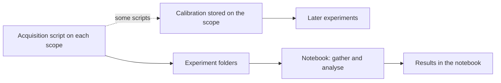

# Calibrations

Calibration is central to the correct operation of scientific instruments. Without calibrations, measurements from sensors are meaningless numbers. Here we present a suite of calibrations to characterize each microscope, which uses a general structure followed across all Trappy-Scopes instruments. The role of the calibrations is to characterize each instrument correctly and to also summarize how identical instruments diverge from one another.

## How a calibration works

Every calibration has two halves: acquisition on the scope, then gathering and analysis on a computer.



- **Acquisition** runs on the scope. The scripts live in [trappyscopes](https://github.com/Trappy-Scopes/trappyscopes) under `scripts/`. Each run produces an experiment folder.
- **Gather and analyse** is a Jupyter notebook in the `calibrations/` folder of this repository, one notebook per calibration. It gathers the experiment folders with [trappy-explorer](https://github.com/Trappy-Scopes/trappy-explorer) and contains all of its own maths, so it reads top to bottom.
- **Results** are computed in the notebook. Some scripts also store the calibration locally on the scope, for regular use by later experiments.

## What each calibration page contains

| Section | What it says |
|---|---|
| Purpose | The question the calibration answers |
| Protocol | The acquisition script, the setup, and how long it runs |
| Data | The files and columns a run produces |
| Gather and analyse | The notebook |
| Results | One row per scope |
| Acceptance | The values a scope should meet |
| Persistent records | How many records the calibration writes onto the scope |

## Calibrations

| Calibration | What it measures | Acquisition script |
|---|---|---|
| [LED + camera intensity fluctuations](led_cam_intensity_fluctuations.ipynb) | Noise, drift, timescales and disturbances of the illumination, as the camera sees it | [`longterm/intensity_continuous.py`](https://github.com/Trappy-Scopes/trappyscopes/blob/main/scripts/longterm/intensity_continuous.py) |
| [Storage health](storage_health.ipynb) | Sustained write speed, write stalls, read-back integrity and SMART health of each scope's SSD and SD card | [`debug/storage_health_statistics.py`](https://github.com/Trappy-Scopes/trappyscopes/blob/main/scripts/debug/storage_health_statistics.py) |

## Running a notebook

Every notebook page has two buttons: **Download notebook** and **Open in Colab**.

- **In Colab**, the first code cell installs what Colab lacks and asks for a `.zip` of your experiment folders. For large data, mount Google Drive instead and set `DATA` to the folder.
- **On your own computer**:

```bash
cd calibrations
pip install -r requirements.txt
jupyter lab
```

Set `DATA` at the top of the notebook to your own experiment folder. Each page cites the runs it was made from by experiment ID. That data is not published, so use your own.

## Persistent records

Some calibrations store their result on the scope itself, in the device's shelve (`~/<device name>`, written through `hive/physical.py`), so later experiments can use it. Each page states how many records it writes.
