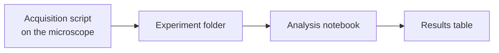

# Calibration

Calibration is central to the correct operation of scientific instruments. Without calibrations, measurements from sensors are meaningless numbers. Here we present a suite of calibrations to characterize each microscope, which uses a general structure followed across all Trappy-Scopes instruments. The role of the calibrations is to characterize each instrument correctly and to also summarize how identical instruments diverge from one another.

## How a calibration works

Every calibration has two halves: an acquisition on the microscope and an analysis on a computer.



- **Acquisition** runs on the microscope. The scripts live in [trappyscopes](https://github.com/Trappy-Scopes/trappyscopes) under `scripts/`. Each run produces an experiment folder.
- **Analysis** is a Jupyter notebook in the `calibrations/` folder of this repository, one notebook per calibration. It reads the experiment folder with [trappy-explorer](https://github.com/Trappy-Scopes/trappy-explorer) and contains all of its own maths, so it reads top to bottom.
- **Results** are computed by the notebook, never typed by hand. The rendered notebook is that calibration's page on this site.

## What each calibration page contains

| Section | What it says |
|---|---|
| Purpose | The question the calibration answers |
| Protocol | The acquisition script, the setup, and how long it runs |
| Data | The files and columns a run produces |
| Analysis | The notebook |
| Results | One row per microscope |
| Acceptance | The values a microscope should meet |
| Persistent records | How many records the calibration writes onto the microscope |

## Calibrations

| Calibration | What it measures | Acquisition script | Status |
|---|---|---|---|
| LED + camera intensity fluctuations | Noise, drift, timescales and disturbances of the illumination, as the camera sees it | [`longterm/intensity_continuous.py`](https://github.com/Trappy-Scopes/trappyscopes/blob/main/scripts/longterm/intensity_continuous.py) | In progress |
| Control voltage vs intensity | LED output against control voltage, per channel | [`calibration/control_volt_vs_sample_intensity.py`](https://github.com/Trappy-Scopes/trappyscopes/blob/main/scripts/calibration/control_volt_vs_sample_intensity.py) | Planned |
| Light stability | Long-term light level on the lux sensor | [`calibration/light_stability.py`](https://github.com/Trappy-Scopes/trappyscopes/blob/main/scripts/calibration/light_stability.py) | Planned |
| Camera colour | Crosstalk between colour channels, and which tuning file is in use | [`calibration/camtests/ccm_crosstalk_test.py`](https://github.com/Trappy-Scopes/trappyscopes/blob/main/scripts/calibration/camtests/ccm_crosstalk_test.py) | Planned |
| Optics | Köhler alignment, USAF resolution target, beads | [`calibration/kolher.py`](https://github.com/Trappy-Scopes/trappyscopes/blob/main/scripts/calibration/kolher.py), [`calibration/complete_calibration.py`](https://github.com/Trappy-Scopes/trappyscopes/blob/main/scripts/calibration/complete_calibration.py) | Planned |
| Temperature and humidity | Long-term temperature and humidity at the microscope | [`calibration/tandh_longterm.py`](https://github.com/Trappy-Scopes/trappyscopes/blob/main/scripts/calibration/tandh_longterm.py) | Planned |
| Pump flow | Peristaltic pump flow rate | [`calibration/peristaltic/pump1_flow_calibration.py`](https://github.com/Trappy-Scopes/trappyscopes/blob/main/scripts/calibration/peristaltic/pump1_flow_calibration.py) | Planned |

## Running a notebook

```bash
cd calibrations
pip install -r requirements.txt
jupyter lab
```

Set the data path at the top of the notebook to your own experiment folder. Each page cites the runs it was made from by experiment ID. That data is not published, so use your own.

## Persistent records

Some calibrations will store their result on the microscope itself, in the device's shelve (`~/<device name>` on the microscope, written through `hive/physical.py`), so later experiments can use it. Each page states how many records it writes. Most write none today.
